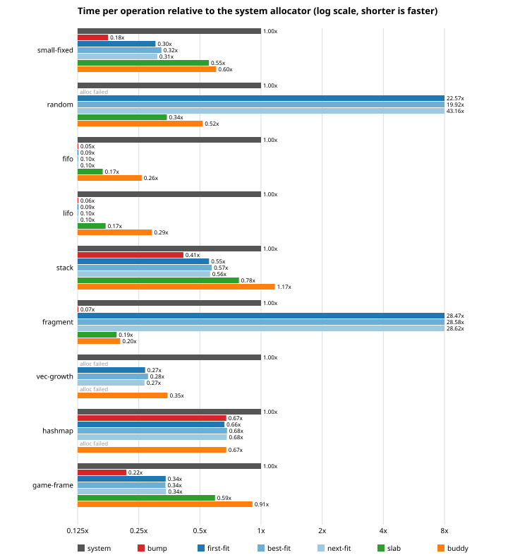

# allocator-lab

Four classic memory allocators written from scratch in Rust (bump, free list,
slab and buddy), each one a `GlobalAlloc` over a fixed region of memory. You
can install any of them as `#[global_allocator]`, and every one of them runs
under Miri.

I started this to understand what happens between `Box::new` and the bytes
it gets back, and to practice writing `unsafe` code I can defend line by
line. Each allocator has a design doc with its invariants. A shared test
suite and property tests run against all four, and the whole workspace
passes `cargo miri test` with strict provenance.

[Leia em português](README.pt-BR.md).

## The four strategies

| | bump | free list | slab | buddy |
|---|---|---|---|---|
| allocation | move a cursor | walk an address-ordered list | pop the lowest free bit of a slab | scan a bitmap, split |
| free | nothing (reset all at once) | walk to the insertion point, merge neighbors | set one bit | merge with buddies while free |
| per-block overhead | alignment padding | 16-byte header, 16-byte rounding | rounding to a power of two | rounding to a power of two |
| sizes served | any | any | up to 2048 bytes | any power of two that fits |
| in-place realloc | last block only | grow into a free neighbor, shrink always | within the size class | grow into free buddies, shrink always |

The design docs explain each one, with diagrams and the invariants the
`unsafe` code relies on: [bump](docs/bump.md), [free list](docs/freelist.md),
[slab](docs/slab.md) and [buddy](docs/buddy.md).

All four share the same groundwork, in `core` (published as `alloc-core`).
A `Region` is an ownership token for a range of bytes, `Arena<N>` is a
4096-aligned static to back one, and there is a small spinlock and alignment
helpers that check for overflow. Two optional features exist per allocator.
`stats` counts requests, bytes and the peak. `debug-checks` re-verifies the
documented invariants after every operation and aborts with a message if one
breaks.

## Results

Nanoseconds per operation, median of 7 runs, on a Ryzen 9 7950X under
Windows 11. The baseline is `std::alloc::System`, which there is the Windows
process heap.

| scenario | system | bump | first fit | slab | buddy |
|---|---|---|---|---|---|
| 20 000 blocks of 32 B | 19.1 | 3.4 | 5.8 | 10.6 | 11.5 |
| random alloc/free, 8 to 2048 B | 40.1 | out of memory | 905.6 | 13.8 | 20.7 |
| free every other block, then larger requests | 54.9 | 3.6 | 1562.3 | 10.7 | 11.1 |
| 200 frames of 1 000 short-lived allocations | 18.2 | 3.9 | 6.2 | 10.8 | 16.5 |



What I take from it: the lab allocators are fast mainly because they do so
little (one region, one lock, no thread caches, no hardening). The free list
falls apart as soon as its list gets long, because every operation walks it.
Slab and buddy stay flat on every pattern they serve. Bump is unbeatable when
everything dies at once and useless otherwise. The full tables, including
best fit, next fit, `Vec` and `HashMap` workloads and memory overhead, are in
[docs/bench-results.md](docs/bench-results.md), and
[docs/BENCHMARKS.md](docs/BENCHMARKS.md) explains how they are measured and
what the caveats are.

## Running it

Everything uses the toolchain pinned in `rust-toolchain.toml`, except Miri,
which needs nightly.

```
cargo test --workspace                     # unit, shared, property and integration tests
cargo test --workspace --all-features      # same, with stats and invariant checks on

rustup toolchain install nightly --component miri,rust-src
MIRIFLAGS=-Zmiri-strict-provenance cargo +nightly miri test --workspace --exclude bench

cargo run --release -p bench               # print the benchmark tables
cargo run --release -p bench -- --write    # also regenerate docs/bench-results.md and the charts
```

The default test profile is sized so Miri finishes in under two minutes.
`LAB_FULL=1` runs many more property-test cases.
[docs/TESTING.md](docs/TESTING.md) covers what each layer of tests checks
and how the profiles work.

## Layout

```
core/          alloc-core: Region, Arena, SpinLock, alignment, AllocError, Stats
bump/          bump allocator
freelist/      free-list allocator: first, best and next fit
slab/          slab allocator, size classes 16..2048
buddy/         buddy allocator
shared-tests/  tests that run against all four, property tests, global allocator tests
bench/         benchmark harness and report generator
docs/          design docs, unsafe audit, testing and benchmark notes
```

## Unsafe policy

- Every `unsafe` block has a `SAFETY:` comment saying which invariant makes
  it sound, and every `unsafe fn` documents its contract under `# Safety`.
  Clippy denies the code otherwise.
- `unsafe_op_in_unsafe_fn` is denied, so an `unsafe fn` does not turn its
  whole body into an unchecked zone.
- Each allocator keeps its pointer dereferences in a small `raw` module.
  The rest of the code works with integer addresses and only promises
  `raw` what it needs.
- The invariants are written down in the design docs and checked at
  runtime by `debug-checks`.
- [docs/UNSAFE_AUDIT.md](docs/UNSAFE_AUDIT.md) lists every unsafe site, why
  it is sound and which tests exercise it.

## Lessons learned

These are the things that actually went wrong or surprised me.

**Miri caught a broken lock contract on day one.** `SpinLock::try_lock` used
`compare_exchange_weak`, which is allowed to fail spuriously. Miri simulates
that, so a test asserting that `try_lock` succeeds on a free lock failed.
`try_lock` uses the strong version now. `lock` calls it in a loop, so it
picks up the strong exchange too, at no measurable cost.

**My first buddy and slab designs were unsound as global allocators.** Both
kept their free lists inside the freed blocks, which is the textbook
approach. Every per-instance test passed under Miri. Then I installed them as
`#[global_allocator]` and Miri reported undefined behavior under both
Stacked Borrows and Tree Borrows. When a thread starts, std frees a `Box`
while that box is still a protected argument of the function freeing it, and
`dealloc` then wrote into those bytes through another pointer. The free list
was fine only by luck of layout, since its header sits before the payload.
I redesigned both: buddy keeps everything in a bitmap, slab in a table at
the end of the region, and neither writes to block memory anymore. Buddy
allocation became a bitmap scan, and the benchmark shows what it costs.

**I only ran `cargo doc` one crate at a time, and missed a broken one.** An
intra-doc link to `pointer::with_addr`, from the first commit of `Region`,
is rejected by rustdoc (linking to raw-pointer methods is still
experimental). Documenting a single allocator crate with `--no-deps` never
built `core`'s docs, so it went unnoticed for 27 commits, until the first
`cargo doc --workspace`. That command, with `-D warnings`, runs in CI now.

**The slab allocator cannot host the test harness.** libtest allocates more
than 2048 bytes before running a single test, and the slab allocator refuses
that by design. Its global allocator test runs with `harness = false` and a
plain `main`.

**Miri needed a test profile of its own.** The property tests took five
minutes under Miri, because every step re-reads every live byte to detect
corruption. The buddy tests took two minutes, almost all of it one round
trip over every 16-byte block of the area. Smaller sizes and
fewer cases under `cfg!(miri)` brought the full Miri run under two minutes.
`LAB_FULL=1` keeps the big runs available.

**Several of my test expectations were wrong, and the allocators were
right.** The clearest one: I expected the buddy allocator to split the first
root, but it splits the smallest root that fits, which is better. Writing the
expected value by hand before running the test caught more misunderstandings
on my side than bugs.

**I reverted one decision.** I planned the free-list placement policy as a
type parameter, then switched to an enum argument, so the tests and the
benchmark can loop over all three policies with a single type.

## License

MIT, see [LICENSE](LICENSE).
