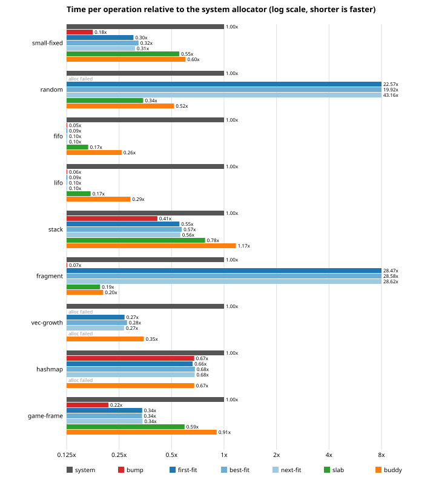

# allocator-lab

Quatro alocadores de memória clássicos escritos do zero em Rust: bump, lista
livre (free list), slab e buddy. Cada um implementa `GlobalAlloc` sobre uma
região fixa de memória, pode ser instalado como `#[global_allocator]` e roda
sob o Miri.

Comecei o projeto para entender o que acontece entre um `Box::new` e os
bytes que ele recebe de volta, e para treinar escrever `unsafe` que eu consiga
justificar linha por linha. Cada alocador tem um documento de design com as
suas invariantes. Uma suíte de testes compartilhada e testes de propriedades
rodam contra os quatro, e o workspace inteiro passa no `cargo miri test` com
proveniência estrita.

[Read in English](README.md).

## As quatro estratégias

| | bump | lista livre | slab | buddy |
|---|---|---|---|---|
| alocação | avança um cursor | percorre uma lista ordenada por endereço | pega o primeiro bit livre de um slab | varre um bitmap e divide |
| liberação | nada (reset de tudo de uma vez) | acha a posição na lista e funde vizinhos | liga um bit | funde com o buddy enquanto ele estiver livre |
| custo por bloco | padding de alinhamento | cabeçalho de 16 bytes, arredonda para 16 | arredonda para potência de dois | arredonda para potência de dois |
| tamanhos | qualquer | qualquer | até 2048 bytes | qualquer potência de dois que caiba |
| realloc no lugar | só o último bloco | cresce sobre vizinho livre, encolhe sempre | dentro da mesma classe | cresce sobre buddies livres, encolhe sempre |

Os documentos de design (em inglês) explicam cada um, com diagramas e as
invariantes de que o código `unsafe` depende: [bump](docs/bump.md),
[lista livre](docs/freelist.md), [slab](docs/slab.md) e [buddy](docs/buddy.md).

A base comum fica em `core` (o pacote se chama `alloc-core`). `Region`
representa a posse exclusiva de um trecho de memória e `Arena<N>` é um
`static` alinhado a 4096 que serve de fundo para uma região. Também ficam lá
um spinlock simples e as funções de alinhamento que checam overflow. Cada
alocador tem duas features opcionais: `stats` conta pedidos, bytes e o pico,
e `debug-checks` confere as invariantes documentadas depois de cada operação,
abortando com uma mensagem se alguma quebrar.

## Resultados

Nanossegundos por operação, mediana de 7 execuções, num Ryzen 9 7950X com
Windows 11. A referência é o `std::alloc::System`, que no Windows é o heap do
processo.

| cenário | sistema | bump | first fit | slab | buddy |
|---|---|---|---|---|---|
| 20 000 blocos de 32 B | 19,1 | 3,4 | 5,8 | 10,6 | 11,5 |
| alocação e liberação aleatórias, 8 a 2048 B | 40,1 | sem memória | 905,6 | 13,8 | 20,7 |
| libera um bloco sim, um não, depois pede maiores | 54,9 | 3,6 | 1562,3 | 10,7 | 11,1 |
| 200 frames de 1 000 alocações de vida curta | 18,2 | 3,9 | 6,2 | 10,8 | 16,5 |



A leitura que eu faço: os alocadores do laboratório são rápidos
principalmente porque fazem pouco. É uma região só e um lock só, sem cache
por thread e sem nenhuma proteção extra. A lista livre desmorona quando a
lista cresce, porque toda operação percorre a lista. Slab e buddy ficam
estáveis em qualquer padrão que conseguem atender. O bump é imbatível quando
tudo morre junto e inútil no resto. As tabelas completas, com best fit, next
fit, `Vec`, `HashMap` e o desperdício de memória, estão em
[docs/bench-results.md](docs/bench-results.md). O
[docs/BENCHMARKS.md](docs/BENCHMARKS.md) explica como medi e quais são as
ressalvas.

## Como rodar

Tudo usa a toolchain fixada em `rust-toolchain.toml`, menos o Miri, que
precisa da nightly.

```
cargo test --workspace                     # testes unitários, compartilhados, de propriedades e de integração
cargo test --workspace --all-features      # o mesmo, com stats e conferência de invariantes

rustup toolchain install nightly --component miri,rust-src
MIRIFLAGS=-Zmiri-strict-provenance cargo +nightly miri test --workspace --exclude bench

cargo run --release -p bench               # imprime as tabelas de benchmark
cargo run --release -p bench -- --write    # também regera docs/bench-results.md e os gráficos
```

O perfil padrão de testes foi dimensionado para o Miri terminar em menos de
dois minutos. Com `LAB_FULL=1`, os testes de propriedades rodam muito mais
casos. O [docs/TESTING.md](docs/TESTING.md) explica o que cada camada de
testes confere e como os perfis funcionam.

## Estrutura

```
core/          alloc-core: Region, Arena, SpinLock, alinhamento, AllocError, Stats
bump/          alocador bump
freelist/      lista livre: first, best e next fit
slab/          alocador slab, classes de 16 a 2048
buddy/         alocador buddy
shared-tests/  testes contra os quatro, testes de propriedades, testes como alocador global
bench/         harness de benchmark e gerador do relatório
docs/          design de cada alocador, auditoria de unsafe, notas de teste e benchmark
```

## Política de unsafe

- Todo bloco `unsafe` tem um comentário `SAFETY:` dizendo qual invariante o
  torna correto, e toda `unsafe fn` documenta o contrato em `# Safety`. O
  Clippy recusa o código se faltar.
- `unsafe_op_in_unsafe_fn` está como erro, então uma `unsafe fn` não vira um
  bloco sem checagem do começo ao fim.
- Cada alocador concentra a desreferência de ponteiros num módulo `raw`
  pequeno. O resto do código trabalha com endereços inteiros.
- As invariantes estão escritas nos documentos de design e são conferidas
  em tempo de execução pelo `debug-checks`.
- O [docs/UNSAFE_AUDIT.md](docs/UNSAFE_AUDIT.md) lista cada ponto de unsafe,
  por que ele é correto e quais testes passam por ele.

## O que aprendi

O que deu errado ou me surpreendeu de verdade durante o projeto.

**O Miri pegou um contrato quebrado no spinlock logo no início.** O
`try_lock` usava `compare_exchange_weak`, que pode falhar sem motivo. O Miri
simula essas falhas, e um teste que esperava conseguir o lock livre falhou.
Troquei pela versão forte. O `lock` chama o `try_lock` em loop e passou a
usar a versão forte também, sem custo perceptível.

**A primeira versão do buddy e do slab não era correta como alocador
global.** Os dois guardavam a lista de blocos livres dentro dos próprios
blocos liberados, que é o jeito clássico. Todos os testes por instância
passavam no Miri. Quando instalei os dois como `#[global_allocator]`, o Miri
acusou comportamento indefinido, tanto com Stacked Borrows quanto com Tree
Borrows. Ao iniciar uma thread, a std libera um `Box` que ainda é argumento
protegido da função que o libera, e o `dealloc` escrevia nesses bytes por
outro ponteiro. A lista livre escapou só por causa do layout, já que o
cabeçalho dela fica antes do payload. Refiz os dois: o buddy guarda tudo num
bitmap e o slab numa tabela no fim da região, e nenhum dos dois escreve mais
na memória dos blocos. Em troca, a alocação do buddy virou uma varredura de
bitmap, e o benchmark mostra quanto isso custa.

**Eu rodava `cargo doc` um pacote por vez e deixei passar um quebrado.** Um
link de documentação para `pointer::with_addr`, do primeiro commit da
`Region`, é rejeitado pelo rustdoc (link para método de ponteiro cru ainda é
experimental). Documentar um alocador com `--no-deps` nunca gerava a
documentação do `core`, então o erro ficou escondido por 27 commits, até o
primeiro `cargo doc --workspace`. Esse comando, com `-D warnings`, agora
roda na CI.

**O slab não aguenta o harness de testes.** O libtest aloca mais de 2048
bytes antes de rodar o primeiro teste, e o slab recusa isso por design. O
teste dele como alocador global usa `harness = false` e um `main` simples.

**O Miri precisou de um perfil de testes próprio.** Os testes de
propriedades levavam cinco minutos no Miri, porque cada passo relê todos os
bytes vivos para detectar corrupção. Os testes do buddy levavam dois minutos,
quase todo esse tempo num único teste que percorre cada bloco de 16 bytes da
área. Com tamanhos menores e menos casos sob `cfg!(miri)`, o Miri inteiro
roda em menos de dois minutos, e o `LAB_FULL=1` continua disponível para as
rodadas grandes.

**Várias expectativas dos meus testes estavam erradas, e os alocadores
estavam certos.** O caso mais claro: eu esperava que o buddy dividisse a
primeira raiz, mas ele divide a menor raiz que comporta o pedido, o que é
melhor. Escrever o valor esperado à mão antes de rodar o teste revelou mais
mal-entendidos meus do que bugs.

**Voltei atrás numa decisão.** Planejei a política da lista livre como
parâmetro de tipo e acabei trocando por um enum no construtor, para os
testes e o benchmark percorrerem as três políticas com um tipo só.

## Licença

MIT, veja [LICENSE](LICENSE).
