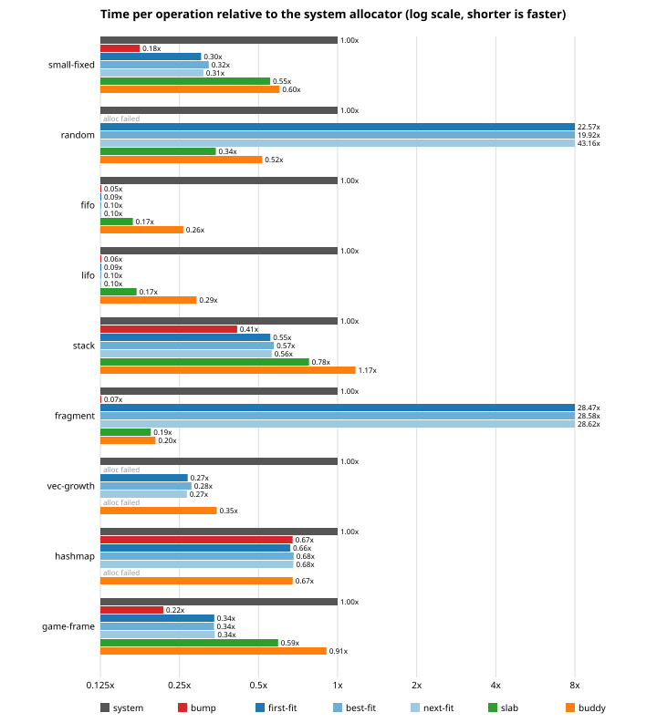
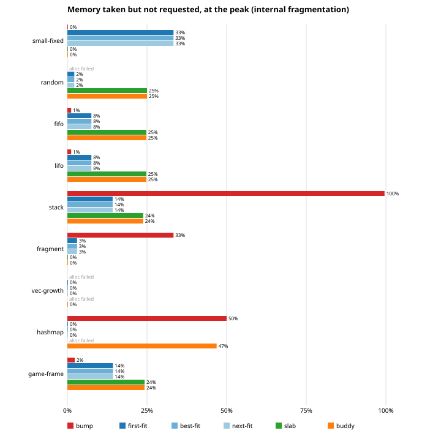

# Benchmarks

The full tables are in [bench-results.md](bench-results.md), generated by the
harness. This page explains how they are produced and what I read in them.

## Running

```
cargo run --release -p bench             # print the tables
cargo run --release -p bench -- --write  # also rewrite docs/bench-results.md and docs/img/*.svg
```

A full run takes about five seconds.

## How it measures

I did not use criterion. The workloads that matter most (`Vec` growth,
`HashMap` churn) need the allocator installed as `#[global_allocator]`, and
criterion allocates its own data inside the measured process. Its samples,
statistics and output would run on the allocator being measured. They would
also fail outright on the slab allocator, which refuses anything above 2048
bytes.

So the bench binary has its own global allocator, `Switch`
(`bench/src/switch.rs`). All six lab configurations live in `static`s with
their own 16 MiB arenas. `Switch` sends new allocations to whichever one is
active and frees every pointer to the allocator whose region contains it, so
memory the runtime allocated before the switch goes back to the system.

Each (allocator, scenario) pair runs in a separate child process, started by
the same binary with `--child`. That gives every pair a fresh arena. It also
means a failed allocation, which `Vec` turns into an abort, kills only that
child, and the table records `alloc failed` instead of losing the whole run.

Inside the child, the scenario runs 7 times and the median is reported. The
lists that track live blocks are allocated by the system allocator before
the switch, with enough capacity that they never grow, so they do not show up
in the numbers.

Caveats:

- The lab allocators run with the `stats` feature on, since that is where
  the memory numbers come from. It adds a few integer updates under a lock
  that is already held.
- The baseline is `std::alloc::System`, which on Windows is the process heap
  (`HeapAlloc`). On Linux it would be glibc `malloc`, which would give
  different numbers.
- Everything is single-threaded. The spinlock is never contended here.
- The numbers below come from one machine: Ryzen 9 7950X, 32 GB, Windows 11,
  Rust 1.95.0. Two consecutive runs agreed within about 5%.

## Time



The first surprise: on almost every pattern the lab allocators beat the
system heap, by a lot. This is not because they are clever. They do much
less: one fixed region, one lock, no thread caches, no returning memory to
the OS, no security hardening. `HeapAlloc` does all of that on every call.
The comparison is useful for seeing the relative costs of the four
strategies, not as a claim that any of them should replace the system
allocator.

Bump is the fastest wherever it can run at all: about 3.4 ns per operation
on `small-fixed`, `fifo` and `lifo`, against 18 to 60 ns for the system heap.
`game-frame` is the case it was made for: 4.0 ns per operation with a reset
per frame. It fails on `random` and `vec-growth`, because without freeing,
50 000 random allocations or 20 rounds of `Vec` growth do not fit in 16 MiB.

The free-list allocator is fast while its list stays short (5.5 to 11.5 ns)
and collapses when it does not. In `random` and `fragment`, the list grows to
thousands of holes, and both allocation and freeing walk it, so an
operation costs 800 to 1 700 ns, 20 to 40 times slower than the system
heap. Next fit is the worst on `random` (about 1 750 ns against 900 for
first fit). I have not instrumented why. My guess is that the rover keeps
the search in the fragmented middle of the list, while first fit keeps
finding room in the low addresses where freed blocks have merged. Best fit
is slightly faster than first fit there. These are the numbers behind the
"O(n) free" note in [freelist.md](freelist.md).

Slab and buddy do not care about the history: 10 to 21 ns on every pattern
they can serve. Buddy is usually the slower of the two, because finding a
block means scanning a bitmap and splitting, while slab finds the first set
bit in at most four words.

In `vec-growth`, every allocator that grows the block in place (free list,
buddy) beats the system heap by four to five times. That scenario counts
pushes, not allocator calls, and most pushes do not allocate.

## Memory



Internal fragmentation is measured at each scenario's peak as
`1 - requested / used`, where `used` is what the allocator took out of its
free space.

- The free list pays its 16-byte header per block: 33% on 32-byte blocks,
  8% on blocks of 64 to 512 bytes, close to 0 on large `Vec` buffers.
- Slab and buddy both pay for rounding to powers of two: 24-25% on uniformly
  random sizes, matching the expected quarter, and nothing when the sizes
  are already powers of two (`small-fixed`, `fragment`).
- Buddy reaches 47% in `hashmap`. Hash table buckets come in power-of-two
  counts plus a few control bytes, so each table lands just over a power of
  two and the block doubles.
- Bump has no per-block overhead. Its "waste" is everything freed and not
  reclaimed: 100% in `stack` at the end of the run, 50% in `hashmap` after
  rehashes.

External fragmentation (`1 - largest free block / free bytes`) needs a
caveat for buddy. Its area is 16 MiB minus the bitmap, which is not a power
of two. The largest block is therefore 8 MiB even when everything is free,
and the metric starts near 50%. For the free list the number means
something: 12% in `fragment`, where 6 000 freed 256-byte holes sit between
live blocks and none can serve the follow-up 1024-byte requests, and 21% for
next fit in `random`.
