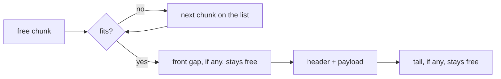

# Free-list allocator

A general-purpose allocator: blocks of any size and alignment, freed in any
order, with free space merged back together. It is the closest of the four to
what a real `malloc` does, and the one with the most ways to get the pointer
math wrong.

## Layout

The usable part of the region (the region trimmed to 16-byte boundaries, which
I call the span) is always tiled by chunks, with no gaps between them. A chunk
is either used or free.

```
 span.start                                                    span.end
 |                                                                   |
 +---+-------+---+-----------+---+-----------+---+---+---------------+
 | H |  data | N |   free    | H |   data    | H | d | N |   free    |
 +---+-------+---+-----------+---+-----------+---+---+---+-----------+
               |                                       ^
               +---------------------------------------+
                         N.next, in address order

 H: header of a used chunk (size, tag), 16 bytes
 N: node at the start of a free chunk (size, next), 16 bytes
```

Every chunk starts and ends on a 16-byte boundary (`UNIT`). A used chunk
begins with a header holding its size and a tag, and the payload starts right
after it. A free chunk begins with a node holding its size and the address of
the next free chunk. The free list is a singly linked list sorted by address.

Because everything is a multiple of 16, any leftover produced by splitting a
chunk is either empty or big enough to hold a node. Nothing is ever too small
to put back on the list, so there is no slop to track.

## Allocation

For a request of `size` bytes aligned to `align`, a free chunk at `at` fits
if, with `payload = align_up(at + 16, max(align, 16))` and
`end = align_up(payload + size, 16)`, `end` is still inside the chunk. The
header goes at `payload - 16`. The used chunk becomes `payload - 16 .. end`,
and whatever is left in front of it and behind it goes back on the list in
the old chunk's place.



The front gap is what makes large alignments cheap. A 4096-aligned request
does not waste up to 4095 bytes: the gap before the header goes back on the
list and other requests can use it.

## Placement policies

The policy is a constructor argument, `FreeList::new(region, Fit::First)`. My
original plan was a type parameter. I switched to a plain enum so the shared
tests and the benchmark can loop over the three policies with a single type,
at the cost of a `match` per visited chunk.

- **First fit** takes the lowest-addressed chunk that fits.
- **Best fit** takes the smallest chunk that fits. It has to walk the whole
  list, unless it finds a chunk with no front gap and no tail.
- **Next fit** takes the first chunk that fits at or after the end of the
  previous allocation and wraps around if nothing does. The resume point
  (`rover`) is an address, not a pointer to a chunk. Merging and splitting
  can make any given chunk disappear, and an address needs no fixing when
  that happens.

The benchmark report compares how they behave on the same workloads.

## Freeing and coalescing

`dealloc` reads the header right before the pointer, walks the list to find
where the chunk belongs, and merges it with the free chunk right before it,
the one right after it, or both. Freeing is O(number of free chunks), which is
the real weakness of this design.

Boundary tags (a footer with the size at the end of every chunk) would make
merging O(1), because the neighbors can be found without walking the list.
But first fit and next fit both rely on address order, and keeping the list
sorted would still need the walk. I kept the address-ordered list and accepted
the O(n) free.

## realloc

Shrinking always happens in place: the tail becomes a free chunk and merges
with whatever free chunk follows it. Growing happens in place when the chunk
right after the block is free and large enough. In that case the block takes
what it needs and the rest stays free. Anything else is an allocation, a copy
and a free, all under the same lock.

## Invariants

When the lock is not held:

1. Chunk starts and sizes are multiples of `UNIT`, and every chunk is at least
   `UNIT` bytes long.
2. Chunks tile the span exactly. As a consequence, the free bytes plus the
   used chunk bytes add up to `capacity()`.
3. The free list is strictly increasing by address, and every node is inside
   the span.
4. No two free chunks are adjacent: for consecutive free chunks `a` and `b`,
   `a + a.size < b`.
5. Every live payload `p` has a header at `p - 16` with `tag == TAG`, and
   `p + layout.size()` is at most the end of its chunk.

Invariant 4 is the coalescing guarantee. Without it, a large request can fail
even though the free space adds up to enough. The test
`fragmentation_can_fail_with_enough_free_bytes` shows what is left once
coalescing is accounted for: holes separated by live blocks can still make a
request fail, and that is real external fragmentation.

The `debug-checks` feature walks the list after every operation and verifies
1, 3 and 4. It also verifies 2 by checking that the free bytes plus the bytes
of live chunks equal the capacity.
